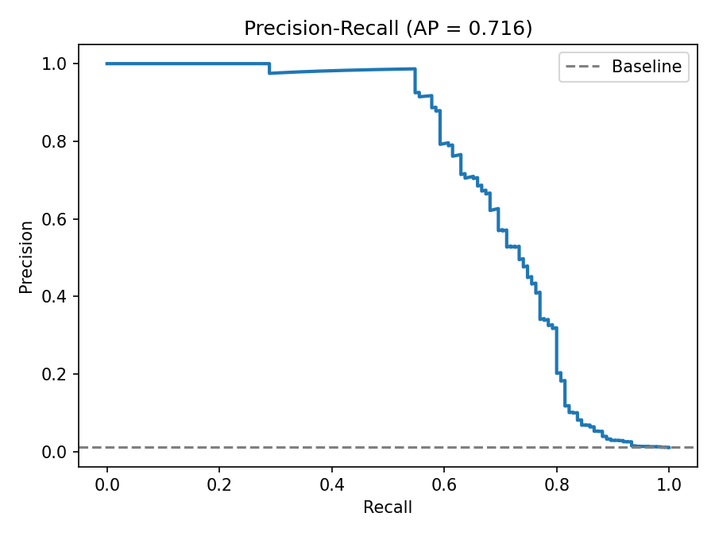
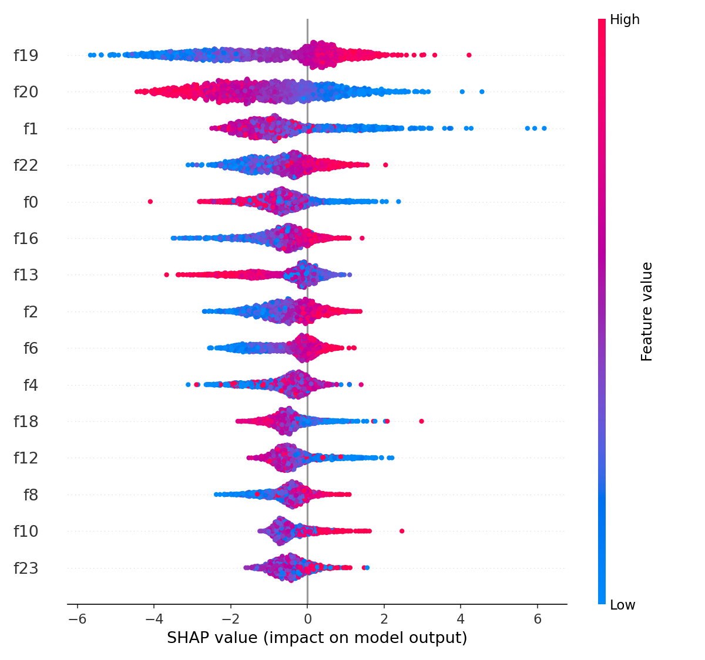

# fraud-detection-ml
Fraud detection with stacking ensemble, Optuna and SHAP
# 🔍 Fraud Detection with a Stacking Ensemble and SHAP

Fraud is rare, which makes it hard to catch. In this project, only about **1 in 90 transactions** is fraudulent, so a model that says "everything is fine" would already be 99% accurate and completely useless. I built this project to tackle that problem properly: pick the right metric, handle the imbalance, and explain what the model is actually doing.

> **Note:** This project uses a simulated dataset (60,000 transactions, ~1.1% fraud) generated with scikit-learn. It's built to demonstrate the full workflow, not to represent a real bank's data.

---

## What I built

- **Hyperparameter tuning** with Optuna, optimizing for PR-AUC instead of accuracy
- **Stacking ensemble** that combines XGBoost and LightGBM, with a Logistic Regression model that learns how to blend them
- **Imbalance handling** using class weighting, so the model pays attention to the rare fraud cases
- **Cost-based threshold**: missing a fraud is far more expensive than a false alarm, so the decision cutoff is chosen to minimize total cost, not just set to 0.5
- **Explainability** with SHAP, so every prediction can be traced back to the features that drove it
- **FastAPI endpoint** (`app.py`) for scoring transactions in real time

---

## Results

Evaluated on a held-out test set of 12,000 transactions (135 of them fraud):

| Metric | Score |
|---|---|
| ROC-AUC | **0.917** |
| PR-AUC | **0.716** |
| Fraud recall | **77%** |
| Fraud precision | **37%** |

In plain words: the model catches roughly **3 out of every 4 fraudulent transactions**. Precision is lower because the threshold favors catching fraud over avoiding false alarms, which is the trade-off many real fraud teams choose.

### Precision-Recall curve





### What drives the predictions (SHAP)





---

## How to run it

```bash
# 1. Install dependencies
pip install -r requirements.txt

# 2. Train the model (saves results to the outputs/ folder)
python train.py --trials 15

# 3. Start the API
uvicorn app:app --reload